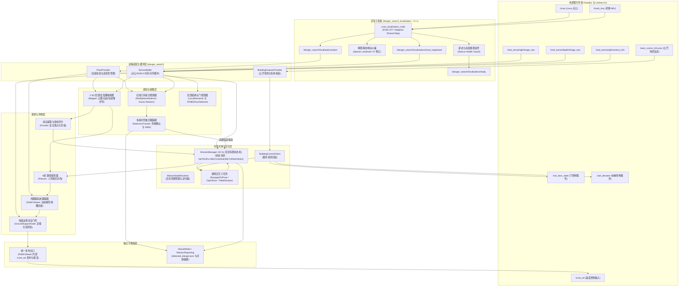
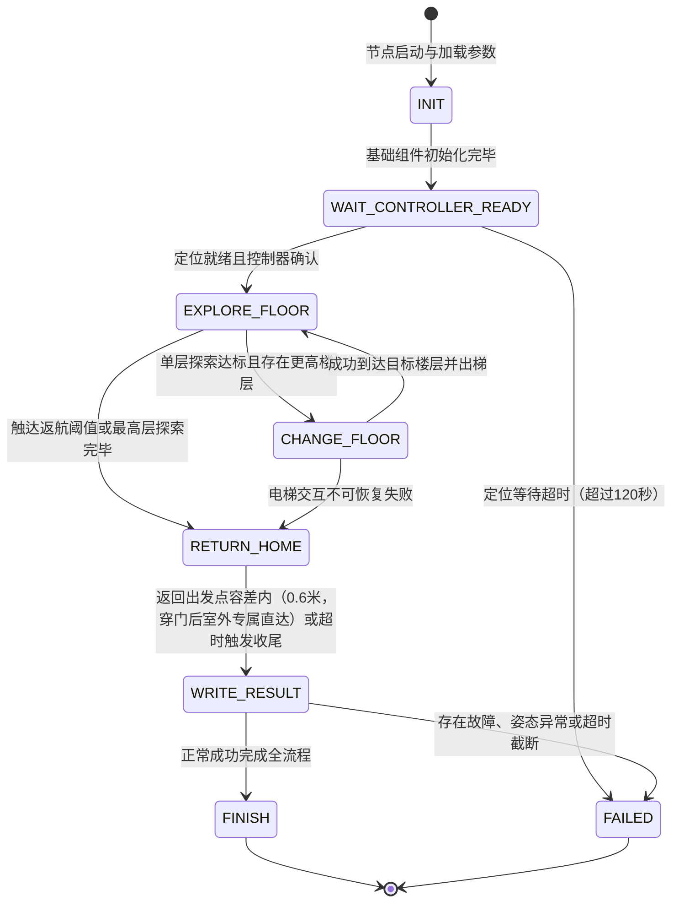

# 基于四足机器人的危险源自主搜索与识别系统：软件系统实现与代码组织

本文件面向项目整体工程实现与代码组织结构，聚焦于参赛自研核心算法体系（`SimEnv/src/danger_search` 与 `SimEnv/src/danger_search_localization`），将赛方环境与底座（Gazebo / A1 / junior_ctrl）作为外部运行背景与接口依赖，详细阐述系统的软件总体架构、核心代码目录划分、主要功能程序模块、启动方式与运行流程、参数配置体系、输入输出文件规范、日志与诊断机制，以及软件依赖与环境构建方式。

---

## 一、软件总体结构

### 1.1 系统定位与技术栈

本软件系统是一套面向多楼层室内未知环境的四足机器人自主搜索与识别系统。基于 **ROS 1 Noetic** 与 **Gazebo 11** 仿真平台，控制搭载 Livox Mid-360 激光雷达、RealSense 深度相机及机体 IMU 的宇树 Unitree A1 四足机器人，在完全不依赖仿真真值、全局先验地图或未公开控制通道的前提下，实现以下核心目标：
1. **全自主多楼层环境探索**：从室外出发，自主完成主入口识别通过、多房间安全前沿探索、电梯呼梯与跨楼层作业；
2. **高精度危险源定位识别**：自主发现未知房间内的红色球体危险源，滤除红色方块、绿色球体等干扰项，输出精准的世界坐标；
3. **安全闭环与时限预算交付**：实时进行地面支撑与跌倒健康监测，在额定时限内安全返回原点并落盘任务结果文件。

### 1.2 系统分层架构与数据流

自研软件系统采用自底向上的分层解耦设计，严格遵循单向依赖与接口合规闭环原则，各层职责如下：
- **边缘适配与缓冲层（Adapters & Buffers）**：封装 ROS 话题与服务接口，提供线程安全的时间同步点云、图像与位姿缓冲，严格校验接口白名单；
- **激光惯性定位与健康监控层（Localization & Stance Health）**：基于 C++ 实现自适应共享地图配准（Adaptive Shared Map / KISS-ICP），融合机体 IMU 姿态约束与激光点云，提供持续位姿发布与刚体姿态健康硬门控；
- **分层建图与支撑防坠层（2.5D Mapping & Ground Support Gate）**：构建 0.10m 独立 2.5D 栅格，维护障碍高程、地面有效支撑及历史行驶轨迹保护带；在控制最终出口前执行足端空洞检测与急刹制动门控；
- **安全前沿探索与规划层（Frontier Exploration & A\* Planning）**：从已知自由区域边界提取安全落点前沿，基于收益-代价综合模型进行候选评分与剪枝，通过八邻域 A\* 输出无对角切角的最优路径；
- **视觉识别与多帧跟踪层（Perception & Multi-Tier Tracker）**：基于 RGB-D 颜色分割与几何半径先验进行高斯-牛顿球心拟合（基于 NumPy 矩阵优化），结合三级阶梯残差确认与空间 NMS 算法，实现高置信度危险源确认；
- **建筑交互子状态机层（Building Navigation Tasks）**：实现主入口通行、房门通行与电梯呼叫/乘梯的三阶段（`POSITION -> ALIGN -> CROSS`）局部受控状态机，支持底盘横移受限下的自动平滑降级；
- **顶层编排与时间预算层（Mission Manager & Node Runtime）**：以 10Hz 名义节拍推进顶层状态转移（`INIT -> WAIT_CONTROLLER_READY -> EXPLORE_FLOOR -> CHANGE_FLOOR -> RETURN_HOME -> WRITE_RESULT -> FINISH/FAILED`），调度常规探索、危险源走近核验子任务、换层规划与保守返航预算；
- **最终输出网关层（Command Gateway & Reporting）**：由 `PathFollower` 统一承担最终速度发布入口与保活定时器管理，并在指定诊断路径落盘最终比赛标准结果与结构化运行摘要。



---

## 二、核心代码目录

项目工程主要包含仿真平台、自研核心算法包、离线诊断与评估工具三大部分。自研核心代码严格集中在 `SimEnv/src/` 下的两个专有 ROS 包中，严禁与离线评估工具、仿真生成器逻辑交叉污染。

```text
codeDG/
├── 软件系统实现与代码组织.md        # 本文档：全局工程架构与实现说明
├── run_baseline.sh                 # 顶层自动化基线运行与录包测试脚本（调用专项运行器）
├── 文档/                           # 项目报告与竞赛交付成果文档集
│   ├── 01-技术方案报告.md
│   ├── 02-自测试报告.md
│   ├── 03-使用说明.md
│   ├── 04-项目论文.md
│   └── 导出PDF.py
└── SimEnv/                         # 仿真环境与算法工作空间根目录
    ├── auto.sh                     # 官方仿真底座集成启动脚本
    ├── CMakeLists.txt              # 工作空间顶层构建脚本
    ├── OFFICIAL_FILES.sha256       # 赛方原始文件完整性校验哈希表
    ├── AGENTS.md                   # 参赛系统开发与接口合规约束规范
    ├── TEAM_README.md              # 团队工作空间构建与快速指引
    ├── config/                     # 辅助全局配置
    ├── generated_building/         # 运行时生成场景目录
    │   └── team_scene_info.json    # 唯一允许算法读取的公开场景定义
    ├── results/                    # 任务成果产物与离线评测落盘目录
    │   ├── detected_danger.json    # 比赛指定输出成果（默认自动写出）
    │   └── runs/                   # 显式配置时的诊断运行摘要归档目录
    ├── tools/                      # 测试运维与离线诊断工具包（与生产代码单向隔离）
    │   ├── sim/                    # 仿真场景批处理与专项测试 runner
    │   │   ├── run_elevator_gui_test.sh       # 电梯两层/三层专项 GUI 测试运行器
    │   │   ├── run_localization_seed_matrix.sh # 定位 20-seed 矩阵测试
    │   │   └── run_three_floor_seed_matrix.sh  # 三层完整任务批量矩阵测试
    │   └── offline/                # 离线真值对比、漂移统计与合规审查工具
    │       ├── check_production_boundary.py   # 生产包代码合规与隔离检查脚本
    │       ├── analyze_mission_timing.py      # 任务时间与覆盖度统计分析
    │       └── analyze_localization_drift_bag.py
    └── src/                        # ROS 源码空间
        ├── danger_search/          # [核心自研包 1] Python 主系统：感知、建图、规划、决策
        │   ├── package.xml         # ROS 包清单与依赖定义
        │   ├── CMakeLists.txt      # Catkin 构建脚本
        │   ├── setup.py            # Python 模块安装声明
        │   ├── scripts/            # 可执行入口目录
        │   │   └── danger_search_node  # 主节点启动入口文件
        │   ├── launch/             # 启动入口配置
        │   │   ├── danger_search.launch       # 正式生产总启动入口
        │   │   └── danger_search_smoke.launch # 快速冒烟调试启动文件
        │   ├── config/             # 系统运行核心参数
        │   │   ├── danger_search.yaml         # 全局生产参数定义文件
        │   │   └── elevator_baseline.rviz     # RViz 可视化调试布局
        │   └── danger_search/      # Python 核心业务逻辑包
        │       ├── mission_node_runtime.py    # 节点生命周期、ROS 回调与活性守护
        │       ├── mission_manager.py         # 10Hz 顶层有限状态机调度核心
        │       ├── mission_config.py          # ROS 参数加载与强类型配置快照
        │       ├── mission_components.py      # 核心子组件依赖注入与生命周期管理
        │       ├── mission_reporting.py       # 状态发布与成果写出调度器
        │       ├── pose_provider.py           # 统一位姿输入与连续性状态管理
        │       ├── sensor_buffer.py           # 点云与 RGB-D 线程安全环形缓冲
        │       ├── building_feature_provider.py # 场景公开信息（门/梯）校验解析器
        │       ├── mapper.py                  # 2.5D 占据网格、自由区与轨迹保护带
        │       ├── map_evidence.py            # 低回波多位姿确认与生命周期记账
        │       ├── frontier.py                # 前沿提取、聚类、评分与剪枝
        │       ├── planner.py                 # 八邻域无切角 A* 路径搜索器
        │       ├── navigator.py               # Pure Pursuit 跟踪器与梯形动态走廊
        │       ├── ground_support_gate.py     # 足端扫掠防坠与急刹制动安全门
        │       ├── ground_support_runtime.py  # 支撑安全线程异步证据队列
        │       ├── red_sphere_detector.py     # 视觉分割与高斯-牛顿球体拟合器（NumPy 矩阵求解）
        │       ├── detection_tracker.py       # 候选三级阶梯确认与空间 NMS 跟踪
        │       ├── rgbd_door_detector.py      # RGB-D 门板平面与开门视觉检测
        │       ├── local_semantic_detector.py # 局部点云门洞与轿厢几何提取器
        │       ├── navigation_tasks.py        # 门与电梯三阶段受控导航子状态机
        │       ├── building_control_client.py # ROS 门与电梯服务调用客户端封装
        │       └── result_writer.py           # 比赛指定格式 JSON 产物写出工具
        └── danger_search_localization/  # [核心自研包 2] C++ 核心定位子系统
            ├── package.xml         # ROS 包清单
            ├── CMakeLists.txt      # 依赖 Eigen3, PCL, Sophus 的构建脚本（要求 CMake >= 3.16）
            ├── launch/
            │   └── scan_localization.launch  # 激光惯性定位独立启动文件
            ├── include/            # C++ 头文件目录
            ├── src/
            │   └── scan_localization_node.cpp # Adaptive Shared Map 定位核心实现
            └── third_party/        # 第三方开源算法分发与嵌入
                └── kiss_icp/       # 固定版本的 KISS-ICP 配准核心库
```

---

## 三、主要程序模块

### 3.1 激光惯性定位与姿态健康监控模块

- **核心源码**：`SimEnv/src/danger_search_localization/src/scan_localization_node.cpp`、[`pose_provider.py`](file:///home/xbh/tzb26/codeDG/SimEnv/src/danger_search/danger_search/pose_provider.py)、[`sparse_landmark_relocalizer.py`](file:///home/xbh/tzb26/codeDG/SimEnv/src/danger_search/danger_search/sparse_landmark_relocalizer.py)
- **输入接口**：`/scan`（原始点云）、`/trunk_imu`（机体 IMU）、内部反馈的 `/cmd_vel`（运动初值）
- **输出接口**：`/danger_search/localization/odom`、`/danger_search/localization/cloud_registered`、`/danger_search/localization/ready`、`/danger_search/localization/health`
- **核心实现机制**：
  1. **初始化严格契约**：节点启动后发布 `ready=false`。系统要求机器人处于站立状态，必须连续 **8 帧**激光点云与时间对齐的 IMU 数据同时满足：机身基座高度位于 `[0.20, 0.55]m`、楼面法向 $Z$ 分量 $\ge 0.85$、机体直立法向 $\ge 0.71$ 且角速度小于 $0.30\text{ rad/s}$。满足后方可建立 `world` 坐标系并发布 `ready=true`，有效杜绝趴地状态下初始化错误坐标系；
  2. **自适应共享地图配准（Adaptive Shared Map）**：
     - **姿态确定**：正式后端主要利用时间匹配的 `/trunk_imu` 姿态数据直接约束机体绝对旋转增量，避免纯激光点云退化或惯导双重积分发散；
     - **局部结构地图与平移估计**：维持一个局部体素结构地图。虽然激光原始输入量程为 15m，但该后端内部对结构点进入局部地图施加了严格的距离筛选（`point.norm() < 12.0m`），剔除远端不稳定杂波；以当前帧点云计算平移残差，按约 10Hz 配置期望频率稳定发布配准位姿与点云；
  3. **持续姿态健康监测**：在运行过程中逐帧监测楼面法向与机体倾角，一旦连续 **3 帧**异常（如机体翻倒、悬空或侧滚），立即锁存 `health=false`，上层任务管理系统据此执行 fail-closed 紧急停车；
  4. **稀疏静态地标纠偏（Sparse Landmark Relocalization）**：主要在 Python 侧实现。在主入口及 0 层电梯厅首次经过时建立局部点云静态几何锚点；重访时通过连续 3 帧点云近邻匹配，计算出在世界系下的 **$XY$ 轴平移修正量** 并注入定位节点，消除累积平移漂移；
  5. **位姿统一入口与坐标系白名单门禁（PoseProvider）**：作为全局位姿的单一接收网关，明确接收 `expected_frame_id`（默认 `world`，兼容合法全局系如 `danger_search_relative`）。在里程计回调入口比对 `msg.header.frame_id`，非白名单坐标系直接丢弃并限频警告，严防局部坐标系或传感器原始数据污染全局导航定位。

### 3.2 2.5D 占据与支撑建图模块

- **核心源码**：[`mapper.py`](file:///home/xbh/tzb26/codeDG/SimEnv/src/danger_search/danger_search/mapper.py)、[`map_evidence.py`](file:///home/xbh/tzb26/codeDG/SimEnv/src/danger_search/danger_search/map_evidence.py)
- **输入数据**：已配准世界坐标系点云、经过时间匹配的机器人位姿
- **核心实现机制**：
  1. **分层 2.5D 网格更新**：分辨率设为 0.10m，独立维护每层楼面的栅格状态。栅格类型显式区分为 `UNKNOWN`（未知）、`FREE`（自由通行）、`OCC`（正障碍占据）、`BLACK`（安全禁区/动态负障碍）与 `VISITED`（已探索/通行过）；
  2. **低回波多代次多位姿确认**：针对四足机器人小腿在 Mid-360 视场下产生的自腿伪影，以及地毯/门槛微小起伏，系统引入观测代次与空间位姿分离确认模型。配置中根据 A1 机器人底盘离地间隙（约 0.27m）将 `low_height_max_z` 设为 `0.26m`。高度位于 `0.20~0.26m` 的低回波作为 `LOW_CANDIDATE` 必须在至少 **3 个点云代次** 且来自相隔至少 **0.15m** 的不同位姿共同确认后，才真正标记为阻挡性 `OCC`，防止在原地踏步时将自身误建为障碍；高于 `0.26m` 的障碍（如 0.30m 方块硬障碍）则直接划入 `HIGH_HARD` 单帧生效硬阻挡并膨胀 0.25m，杜绝机身托底；
  3. **历史轨迹核心保护带（Trail Protection Band）**：机器人在行进过程中，沿其中心轨迹以 0.25m 半径维护一条受保护的 `VISITED` 核心带。距离当前机器人超过 2.0m 的远端离群点云，严禁将该通行带直接覆盖为 `OCC`，有效阻断定位慢漂造成的“回程自身锁死”现象。

### 3.3 安全前沿探索与路径规划模块

- **核心源码**：[`frontier.py`](file:///home/xbh/tzb26/codeDG/SimEnv/src/danger_search/danger_search/frontier.py)、[`planner.py`](file:///home/xbh/tzb26/codeDG/SimEnv/src/danger_search/danger_search/planner.py)
- **功能职责**：在未知环境中高效发现可探索前沿，规划安全避障全局路径。
- **核心实现机制**：
  1. **安全落点提取与聚类**：将已知自由格与未知格相邻的边界提取为前沿，执行连通域聚类（过滤小于 4 格的微小簇）。对每个簇计算**安全落点**，落点必须满足距障碍物净距 $\ge 0.25\text{m}$，且退让未知区域边界 $\ge 0.20\text{m}$；
  2. **多目标效用评分模型**：
     $$J(p) = w_g \sqrt{G(p)} - w_d D(p) - w_y Y(p) - w_r R(p)$$
     其中 $G(p)$ 为局部连通未知格预期收益（采用平方根函数，兼顾高价值远区同时防止远距离偏执），$D(p)$ 为 A\* 路径距离代价，$Y(p)$ 为航向偏差代价，$R(p)$ 为回头与禁区惩罚；
  3. **远距离微小孤岛剪枝**：物理规则要求危险源球体（直径 0.3m）生成必须避开墙体家具，远端孤立阴影若连通增益低于 **16 格**且距离大于 **3.5m**，在规划前直接剪枝剔除，避免往返无效折返；
  4. **八邻域无切角 A\* 规划**：起点落在未知区时自适应吸附至最近自由格，但在对角线移动时强制校验两侧正交格的连通性，严禁穿越对角直角墙角；
  5. **跨楼层前沿失败与黑名单隔离**：前沿规划失败计数 `_fail_counts` 与黑名单集合 `_blacklist` 的键值升级为带有楼层维度的 `(floor_index, cell)` 复合键。各楼层二维网格由于投影共享坐标，通过显式绑定楼层号彻底消除跨楼层失败记录污染；同时避免粗暴换层清空导致的记忆丢失，机器狗在重返旧楼层时，原本证明不可达的区域记忆依然有效保留。

### 3.4 运动控制与地面防坠检测机制

- **核心源码**：[`navigator.py`](file:///home/xbh/tzb26/codeDG/SimEnv/src/danger_search/danger_search/navigator.py)、[`ground_support_gate.py`](file:///home/xbh/tzb26/codeDG/SimEnv/src/danger_search/danger_search/ground_support_gate.py)
- **功能职责**：沿规划路径平稳跟踪，并在最终控制出口前进行足端地面支撑与防坠检测拦截。
- **核心实现与适用条件**：
  1. **动态梯形收腰前向走廊（Adaptive Trapezoid Corridor）**：Pure Pursuit 跟踪过程中，在机身前向投影检测障碍点云。前向距离 $\le 0.35\text{m}$ 时走廊半宽收紧为 $0.16\text{m}$，$\ge 0.60\text{m}$ 时扩展为 $0.22\text{m}$，精准贴合 A1 机身物理包络，避免过窄门框立柱边缘点云触发虚假紧急减速；
  2. **足端支撑检测与刹停逻辑**：独立于导航层，在最终下发 `/cmd_vel` 的出口前消费支撑评估结果（异步周期评估，而非每次控制发布重新遍历全部原始点云）。当检测到未来运动走廊前方存在台阶、楼板镂空或悬崖（跌落高度 $\ge 0.30\text{m}$）时，拦截并强制输出零速；
  3. **保守制动包络表与适用限制**：
     - 系统内置离散查表模型（`ConservativeStopEnvelope`），依据请求速度向上取档获取保守刹停距离，超包络时返回 `None` 立即零速；代码注释明确标明表项为工程保守估计，尚待独立测量最终封板；
     - **豁免与限制**：`unknown_support_hold_enabled` 参数默认关闭（即平地激光稀疏时不触发走走停停，仅对明确的负障碍或低回波 DROP 急刹）；0 层及电梯 `ENTER_CABIN/EXIT_CABIN` 的 `CROSS` 阶段由于结构特性存在防坠判定豁免；受控微退不足 0.20m 时转向仍需结合实体正障碍综合防护；
  4. **严密停车与控制熔断机制（Motion Fuse）**：
     - `Navigator.stop()` 在同步锁内不仅发布瞬时零速，且强制调用 `_clear_path_locked` 彻底清空内部活动路径 `_active_path`；
     - 新增 `disable_motion()` 控制熔断状态开关（`_motion_enabled = False`）。在任务层异常捕获、超时停机触发时，底盘控制定时器（20Hz）入口直接短路跳过速度计算并锁定发布零速，最终输出端口 `_publish_locked` 强制夹紧零速，杜绝“状态机已停机、定时器仍沿旧路径发速”的控制逃逸窗口。

### 3.5 视觉识别与多帧时空融合跟踪模块

- **核心源码**：[`red_sphere_detector.py`](file:///home/xbh/tzb26/codeDG/SimEnv/src/danger_search/danger_search/red_sphere_detector.py)、[`detection_tracker.py`](file:///home/xbh/tzb26/codeDG/SimEnv/src/danger_search/danger_search/detection_tracker.py)
- **功能职责**：从 RealSense 同步 RGB 与深度图像中检测目标，完成 3D 几何精确重构与多帧去重确认。
- **核心实现机制**：
  1. **先验物理半径与高斯-牛顿拟合**：RGB 图像经过 HSV 阈值分割提取红色连通域，进行宽高比与圆度初筛；从有效深度反投影得到单侧球冠 3D 点云后，利用已知先验半径 $R=0.15\text{m}$，将初值沿视线方向后移 $R$ 构造物理初值，再基于 **NumPy 矩阵运算** 执行 Gauss-Newton 迭代精确优化拟合球心坐标 $(X, Y, Z)$，计算拟合均方根误差（RMSE）；
  2. **三级阶梯确认规则（Three-Tier Confirmation Ladder）**：为破解“远距离真球因帧数不足漏检”与“单帧误报”的矛盾，引入基于拟合残差的动态阶梯门槛：
     - **Tier 1（极低残差）**：$\text{RMSE} \le 0.005\text{m}$ 且置信度 $\ge 0.70$ 时，仅需 **1 帧** 独立观测即确认为 `CONFIRMED`；
     - **Tier 2（高精度残差）**：$\text{RMSE} \le 0.015\text{m}$ 且置信度 $\ge 0.70$ 时，需 **2 帧** 独立时间戳观测；
     - **Tier 3（常规残差）**：$\text{RMSE} \le 0.035\text{m}$ 且置信度 $\ge 0.75$ 时，需 **4 帧** 独立时间戳观测；
  3. **空间 NMS 与时空加权融合**：采用 **0.50m** 半径进行空间非极大值抑制（NMS）。根据官方场景生成物理约束，两球球心最小物理间距为 $R_1+R_2+\text{clearance} = 0.15+0.15+0.35 = 0.65\text{m}$，旧配置 0.9m 存在抹杀真实相邻双球的严重缺陷；将半径收紧至 0.50m 彻底解除了合法双球误吞，同时足以吸收单球多帧观测在四足运动抖动下的拟合残差，且完全契合裁判评测 1.0m 容差。同一轨迹的不同帧观测根据置信度、距离平方反比与拟合残差进行加权最小二乘融合，消除机体抖动带来的定位方差。

### 3.6 建筑交互与子任务状态机模块

- **核心源码**：[`navigation_tasks.py`](file:///home/xbh/tzb26/codeDG/SimEnv/src/danger_search/danger_search/navigation_tasks.py)、[`building_control_client.py`](file:///home/xbh/tzb26/codeDG/SimEnv/src/danger_search/danger_search/building_control_client.py)
- **功能职责**：管理大门通过、电梯呼叫与进出轿厢等高度结构化操作。
- **核心实现机制**：
  1. **主入口通过子状态机（OpenDoorAndPass）**：到达室外固定观察点 $(0, -1.6)\text{m}$ 后停车清空路径，等待 0.5s 消除机身晃动；利用新鲜点云重新获取门洞中心，调用 `/set_door_state` 服务开门；通过点云确认门洞开启后，以受控低速（$\le 0.44\text{m/s}$）沿门轴直线穿越并深入室内至少 0.8m；在返航出门或近场重观测阶段，若局部点云因狭窄走廊连墙效应在限定时间（3.0s）内未提取出独立门垛，系统对齐电梯降级哲学，平滑降级保留开局已连续确认的高精大门几何（中心坐标、轴线与净宽），标记开门传感器确认并直接放行穿越，坚决杜绝在已开门大门前超时自杀；同时，门洞刷新后统一收口至 `GO_REFRESHED_WAIT_POINT`，废除单帧直跳；重新站位到位退出容差收紧为 $0.20\text{m}$（`_MAIN_ENTRANCE_RECENTER_EXIT_TOLERANCE`），机身在容差内时原地静止等待确认，不调用 `_navigate_to` 产生晃动；对准打断门限设为 $0.30\text{m}$（`_MAIN_ENTRANCE_CENTERLINE_TOLERANCE`），构建 $0.10\text{m}$ 施密特触发器滞回区间并引入由位姿时间戳推进严格驱动的双向连续 2 帧防抖确认机制（`_MAIN_ENTRANCE_RECENTER_CONFIRMATIONS_REQUIRED = 2`）；在对准阶段增设偏离待决（Count=1）硬门禁，严禁提交穿门路径，确保机器人充分平稳回中后再对准穿门，彻底杜绝临界点频繁横跳耗尽重试次数。
  2. **电梯进出轿厢状态机（TakeElevator）**：
     - **候梯准备与侧移降级保护**：导航至电梯门前 1.2m 等待点，以实时点云/视觉刷新门板朝向；若需要横向搜寻门板，系统会检查底盘横移限幅：因生产底层控制器将 `max_lateral` 锁定为 0.01m/s 以避免转向耦合，当检测到底层能力不足（`<0.05m/s`）时，自动跳过无效物理侧移，平滑直接切入呼梯阶段；
     - **呼梯与确认**：调用 `/call_elevator`，等待目标楼层开门确认；
     - **三阶段受控进出（`POSITION -> ALIGN -> CROSS`）**：
       - `POSITION`：调整机身到达门轴中心线，横向偏差严格控制在 0.25m 内；
       - `ALIGN`：原地精确对准进厢/出厢轴线（角度误差 $<0.10\text{rad}$）；
       - `CROSS`：采用去负障碍但保留实体障碍的安全副本，直线跨越门槛；
     - **出厢异步关门**：离开电梯到达目标楼层后，立即激活新楼层地图作用域守卫，异步请求关门并不阻塞当前层的探索规划；
   3. **地标二次对齐超时保活降级机制**：在电梯门前或狭窄通道触发稀疏地标二次对齐时，若定位节点由于点云暂时遮挡超过等待阈值（3.0s），系统严格遵循实战保活优先原则，输出 Warning 日志并发出结构化降级事件 `sparse_landmark_correction_timeout_degraded`；清空门前挂起的强制对齐目标，直接降级沿用当前滤波位姿继续推进开门与导航动作，绝不自杀停机。

### 3.7 顶层任务编排与状态机模块

- **核心源码**：[`mission_manager.py`](file:///home/xbh/tzb26/codeDG/SimEnv/src/danger_search/danger_search/mission_manager.py)、[`mission_node_runtime.py`](file:///home/xbh/tzb26/codeDG/SimEnv/src/danger_search/danger_search/mission_node_runtime.py)
- **功能职责**：以固定 10Hz 名义节拍驱动顶层状态转移，管理全局与单层时间预算，调度任务优先级。

代码中实际定义的顶层核心状态为：
- `INIT`：系统启动与参数载入；
- `WAIT_CONTROLLER_READY`：等待定位锁存就绪与控制器就绪确认；
- `EXPLORE_FLOOR`：单层主要探索状态（包含前沿导航、进门子任务 `OpenDoorAndPass` 与危险源走近核验 `VERIFYING`）；
- `CHANGE_FLOOR`：楼层转移状态（执行电梯呼梯与跨层进出子任务 `TakeElevator`）；
- `RETURN_HOME`：触发全局或局部返航，返回原点；
- `WRITE_RESULT`：冻结状态，写出结果文件；
- `FINISH` / `FAILED`：任务终止状态。



- **危险源走近核验抢占机制（Approach Verification）**：作为 `EXPLORE_FLOOR` 内部的高优先级子任务。当检测器产生置信度 $\ge 0.70$ 的远距离候选目标时，任务管理器主动挂起普通前沿探索，规划安全路径靠近至约 1.3m 的最佳观测视距进行驻留复核；复核完成或达到 30s 单次上限后恢复常规探索；
- **室外专属直达返航机制（Outdoor Direct Return）**：
  - **触发边界与感知解耦**：返航过程中，当主入口穿越子任务完成（`_return_home_main_entrance_crossed == True`）且机器狗处于室外开阔地（$y \le -1.25\text{m}$）时，顶层状态机在 `tick()` 主循环入口与定位决策处实施全面短路隔离：
    - 短路定位监控：静默激光雷达在开阔地大角度打空导致的断流、降频或 stale 异常，无条件放行控制；
    - 短路室内感知建图与安全网：完全跳过三维激光点云配准、局部高程/占据栅格建图、地面支撑安全门（SafetyGate）与地标纠偏，彻底根除室内重型机制在室外开阔空旷地的虚警与急停干扰；
  - **硬目标纯几何导引与直驱发布**：
    - 锁定终点硬导引目标点为 $(0.0, -3.3)$（真实出发点为 $(0.0, -3.2)$），控制器切换至直驱直通模式 `set_outdoor_direct_drive(True)`（透明绕过 `SafetyGate` 拦截）；
    - 以 $0.35\text{m/s}$ 匀速直线南推并进行纯几何朝向 P 控制微调，平稳走完剩余约 $1.35\text{m}$ 直线位移（仅需约 $3.8\text{s}$）；
  - **到站判定与超时保护（基于估计位姿几何闭环）**：
    - 到站软件判据：动态读取全局配置 `home_tolerance`（0.60m），以机器人实时估计位姿距出发点 $(0.0, -3.2)$ 的欧氏几何距离 $\le \text{tolerance}$（`real_dist_to_home <= tolerance`）作为到站成功判据并置位 `_return_home_success = True`；彻底废除历史调试中使用的开环时间盲推（时间满即赋成功）和单轴粗放判定；
    - 物理安全刹车与超时判负：设置 $8.0\text{s}$ 运行物理上限作为防撞与失控保护（$0.35\text{m/s} \times 8.0\text{s} = 2.80\text{m}$，足以越过判定线）。若满 8.0s 仍未进入 $0.60\text{m}$ 圈内，坚决执行物理刹停并如实记录超时判负（`outdoor_direct_return_timeout`），客观上报真实距离与位姿；
    - 满足到达条件时立即刹停停机，退出直驱模式，平滑切入 `WRITE_RESULT` 状态，触发规范的结构化审计记录并安全落盘；
    - **客观说明与局限**：该判据依赖软件定位估计位姿。由于室外直驱阶段短路了定位监控以防激光打空中断，若此时定位存在累积漂移，该判据仅代表估计坐标系下的几何收敛，不能在物理层面上绝对保证真实物理落点完全无偏；该机制目前为代码重构与静态语法检查通过状态，尚待端到端完整仿真运行闭环验证。
- **多层时间预算体系与收尾期限界定**：
  - **名义探索预算**：由 `effective_max_runtime` 结合配置与场景楼层数确定（默认配置现已统一至 1440.0s，单层生效 520s、两层 1000s、三层 1440s）。机器人实时根据位置与保守速度（0.4m/s）预估回程时间，触碰阈值即转入 `RETURN_HOME`；
  - **超时与收尾期限**：若名义预算耗尽仍未到家，系统锁存 `timeout_triggered` 并进入独立收尾保护期（额外预留最多 180 秒任务时间或 600 秒墙钟时间）。在此期间不再开启新任务，专注于安全返航与写出结果；
  - **成功资格判定**：只要在收尾保护期内安全返回起点并写出结果文件，系统视为返航闭环成功并写出结果，由裁判评分脚本按实际耗时进行线性扣分；若超过收尾保护期仍未到家，则标记为失败；
  - **写结果事务与退出时序解耦**：在 `WRITE_RESULT` 阶段，文件落盘与外部测试脚本的退出判定严格解耦。`_reporting.write_result()` 在真正完成磁盘写入与系统 sync 后，显式发出结构化事件 `{"event": "mission_result_written"}`；外部测试脚本以此落盘事件为准安全退出，避免因监听状态跃迁而提前强杀进程导致结果文件损坏。

---

## 四、启动方式与运行流程

系统设计了标准分步生产启动模式与一键自动化运行模式，确保兼顾单步调试与批量评测。

### 4.1 核心时序与就绪约束

在启动算法之前，必须严格遵守以下时序约束：
1. **仿真物理与控制器就绪**：必须等待 Gazebo 模型与 `junior_ctrl` 完全启动。`junior_ctrl` 启动后默认处于前台待命状态；
2. **模式手动切换约束**：必须在 `junior_ctrl` 控制台按 `2` 使四足机器人站立，随后按 `6` 切换进入 **RL `/cmd_vel` 模式**（终端输出 `Entered RL /cmd_vel mode.`）；
3. **定位节点站立健康门禁**：`scan_localization_node` 启动后持续校验机器人高度与 IMU，只有站立稳定后才会输出 `/danger_search/localization/ready = true`；
4. **控制确认参数（controller_ready_ack）**：`danger_search.launch` 启动时必须显式指定 `controller_ready_ack:=true`，表明人工或上层脚本已确认控制器处于 `/cmd_vel` 接管状态；
5. **定位就绪超时保护**：主节点启动后最多有界等待 120 秒墙钟时间；若未收到定位 `ready` 信号，节点将抛出 `TimeoutError` 显式失败退出，严禁在未定位状态下发盲走速度。

---

### 4.2 标准分步生产启动流程（生产推荐）

#### 步骤 1：启动比赛仿真底座

在第一个终端加载环境并启动仿真（可配置随机种子、楼层数与图形界面开关）：

```bash
cd /home/xbh/tzb26/codeDG/SimEnv
source /opt/ros/noetic/setup.bash
source ./devel/setup.bash

# 环境变量配置示例：随机种子 42，2层楼，开启 Gazebo 界面
SEED=42 FLOOR_COUNT=2 GUI=true ./auto.sh
```

#### 步骤 2：切换机器狗运动控制器状态

待 Gazebo 界面完全载入、机器狗出生在室外后，定位至运行 `junior_ctrl` 的终端界面：
1. 输入键盘按键 `2` 并回车：四足机器人执行起立动作；
2. 输入键盘按键 `6` 并回车：切换为强化学习速度跟踪模式，终端打印：
   ```text
   Entered RL /cmd_vel mode.
   ```

#### 步骤 3：启动自研核心算法总系统

打开第二个终端，加载工作空间环境并启动算法总 launch 文件：

```bash
cd /home/xbh/tzb26/codeDG/SimEnv
source /opt/ros/noetic/setup.bash
source ./devel/setup.bash

# 显式传入 controller_ready_ack 确认参数
roslaunch danger_search danger_search.launch controller_ready_ack:=true
```

启动后，系统将依次拉起 C++ 定位节点与 Python 任务节点，待定位锁定后机器狗自动起步执行主入口识别、探索与巡检。

---

### 4.3 自动化与基线评测运行脚本

#### 方式 A：顶层基线脚本（`run_baseline.sh`）

项目根目录提供了全自动脚本 [`run_baseline.sh`](file:///home/xbh/tzb26/codeDG/run_baseline.sh)，该脚本已对接后端标准专项运行器（`tools/sim/run_elevator_gui_test.sh`），自动托管环境加载、底座启停、控制器固定模式切换及状态监控。脚本内部默认配置为 3 层全周期评测（`FLOOR_COUNT=3`、`FULL_CYCLE=1`）：

```bash
cd /home/xbh/tzb26/codeDG

# 默认运行 3 层完整往返基线评测（亦可通过 FLOOR_COUNT=2 指定双层，或 SEED=... 指定随机种子；注：底层评测运行器仅支持 2 或 3 层多楼层往返）
bash run_baseline.sh
```

#### 方式 B：电梯与多楼层专项测试 Runner（`tools/sim/`）

针对跨层探索与电梯专项调试，可直接调用功能全面的专项运行器：

```bash
cd /home/xbh/tzb26/codeDG/SimEnv
source /opt/ros/noetic/setup.bash
source ./devel/setup.bash

# 运行 3 层完整闭环端到端测试（自动执行 0->1->2->0->home）
SEED=42 GUI=true ELEVATOR_TEST_FLOOR_COUNT=3 bash tools/sim/run_elevator_gui_test.sh
```

---

## 五、参数配置说明

本系统的生产参数主要集中在 [`SimEnv/src/danger_search/config/danger_search.yaml`](file:///home/xbh/tzb26/codeDG/SimEnv/src/danger_search/config/danger_search.yaml) 中，并由 `danger_search.launch` 加载至 ROS 参数服务器；此外，部分底层传感器外参、姿态健康阈值与初始点云参数由 `scan_localization.launch` 及其 C++ 节点默认值承载。

### 5.1 全局高频核心参数速查表

| 参数键路径 | 默认值 | 物理含义 | 所属模块 |
|---|---|---|---|
| `runtime/profile` | `formal` | 系统运行模式配置（formal 强制开启严格接口与健康审查） | 全局运行时 |
| `mission/max_runtime` | `1440.0` | 任务名义总最大运行时限上限（秒，由楼层映射表裁决） | 任务编排层 |
| `mission/explore_coverage_ratio` | `0.65` | 单层前沿覆盖率达标阈值（多层默认 0.65 触发换层） | 任务编排层 |
| `controller/max_linear` | `0.65` | 四足机器人巡航最高线速度限制（m/s） | 运动控制层 |
| `controller/max_lateral` | `0.01` | 四足机器人侧向平移速度上限（m/s，防转向耦合） | 运动控制层 |
| `controller/max_angular` | `0.90` | 四足机器人最高旋转角速度限制（rad/s） | 运动控制层 |
| `map/resolution` | `0.10` | 2.5D 栅格地图网格分辨率（米） | 建图层 |
| `frontier/min_cluster_size` | `4` | 构成有效前沿簇的最小栅格数 | 前沿探索层 |
| `detection/target_radius` | `0.15` | 危险源红色球体目标物理先验半径（米） | 视觉识别层 |
| `tracker/min_hits` | `4` | 常规确认危险源所需的最小独立帧数（Tier 3） | 目标跟踪层 |
| `ground_support/production_gate_enabled` | `true` | 地面支撑与防坠硬保护门控开关 | 安全保护层 |

---

### 5.2 各算法子系统详细参数配置

#### 1. 运行时与接口配置 (`runtime` & `topics`)
- `runtime/profile`（默认：`formal`）
  - **物理含义**：运行配置文件类型。
  - **影响机制**：设为 `formal` 时，系统严格执行公开接口白名单校验，强制启用姿态健康门控，禁用任何相对坐标原点或手动目标下发。
- `topics/cmd_vel`（默认：`/cmd_vel`）
  - **物理含义**：输出到底座控制器的速度指令话题名称。
  - **影响机制**：唯一控制输出话题。
- `topics/status`（默认：`/nav/status`）
  - **物理含义**：任务运行状态与诊断信息发布话题。
  - **影响机制**：供外部监视器和测试脚本获取当前任务状态。

#### 2. 定位与位姿服务配置 (`localization`)
- `localization/global_frame_id`（默认：`world`）
  - **物理含义**：全系统唯一的全局参考坐标系名称。
  - **影响机制**：地图、位姿、路径、目标与点云均统一使用该坐标系，禁止多坐标系混用。
- `localization/stale_minimum`（默认：`0.4` 秒）
  - **物理含义**：判定里程计数据出现短时陈旧的最小时间间隔。
  - **影响机制**：超过该时间未更新位姿时，导航控制器立即执行零速等待。
- `localization/unavailable_timeout`（默认：`3.0` 秒）
  - **物理含义**：判定定位完全失效的硬超时上限。
  - **影响机制**：持续 3.0 秒未收到合法位姿，系统立即报告定位故障并中止任务。
- `localization/sparse_relocalization_enabled`（默认：`true`）
  - **物理含义**：稀疏静态地标纠偏算法使能开关。
  - **影响机制**：开启后，系统在主入口和 0 层电梯区域回访时通过点云锚点匹配计算并注入 $XY$ 平移修正量。

#### 3. 任务全局时钟与流程控制 (`mission`)
- `mission/max_runtime`（默认：`1440.0` 秒）
  - **物理含义**：任务总名义预算时间上限。
  - **影响机制**：与 `runtime_by_floor` 配合由 `effective_max_runtime` 取较小值，使 1 层场景自动取 520s、2 层取 1000s、3 层取 1440s。
- `mission/return_safety_buffer`（默认：`5.0` 秒）
  - **物理含义**：在模型估算的返航理论耗时之外额外预留的安全时间冗余量。
  - **影响机制**：提前触发返航状态转移，防止在回程终点前因微小扰动耗尽时间。
- `mission/danger_approach_verification_enabled`（默认：`true`）
  - **物理含义**：危险源远距离候选主动走近精测功能开关。
  - **影响机制**：开启后，置信度达标的高价值远距目标将抢占普通前沿探索。
- `mission/danger_approach_standoff_distance`（默认：`1.3` 米）
  - **物理含义**：走近核验时机器人停靠的目标驻留观测距离。
  - **影响机制**：决定接近路径终点相对于目标球心的偏移量，适配深度相机最佳测距视距。

#### 4. 2.5D 栅格建图配置 (`map`)
- `map/resolution`（默认：`0.10` 米）
  - **物理含义**：栅格地图单格物理边长。
  - **影响机制**：决定环境建图精度与 A\* 状态空间离散粒度。
- `map/obstacle_min_z` 与 `obstacle_max_z`（默认：`0.20` 米 / `1.40` 米）
  - **物理含义**：判定为机身正障碍物点云的高程截取窗口。
  - **影响机制**：过滤低于 0.20m 的地面起伏及高于 1.40m 的天花板回波。
- `map/low_height_max_z`（默认：`0.26` 米）
  - **物理含义**：低障碍物高度上限阈值（严格对齐 A1 底盘 0.27m 离地间隙）。
  - **影响机制**：高度在 `[0.20, 0.26]m` 的微小起伏归入低回波候选，须经多代次多位姿确认才阻挡；超过 0.26m 的点云（如 0.30m 方块硬障碍）直接归入高硬障碍单帧生效阻挡 A* 规划并向外膨胀 0.25m，杜绝机身托底。
- `map/obstacle_inflation_radius`（默认：`0.25` 米）
  - **物理含义**：正障碍物的安全膨胀半径。
  - **影响机制**：在 A\* 规划代价地图中对障碍物外扩，保证机身物理通行安全。
- `map/point_free_clear_max_range`（默认：`8.0` 米）
  - **物理含义**：光束自由射线清除未知区域的最大射程。
  - **影响机制**：限制单帧点云打通远端未知区域的范围，避免因穿透门框虚假打通未探索房间。
- `map/trail_protection_enabled`（默认：`true`）
  - **物理含义**：历史行驶轨迹核心带保护机制开关。
  - **影响机制**：在已行驶过的路径周围保护通道，抑制后续远距杂波将其刷成不可通行。

#### 5. 安全前沿探索配置 (`frontier`)
- `frontier/information_gain_weight`（默认：`0.39`）
  - **物理含义**：前沿效用评分中的信息增益权重 $w_g$。
  - **影响机制**：放大未知区域扩张倾向，引导机器人走向开阔未知空间。
- `frontier/path_cost_weight`（默认：`3.2`）
  - **物理含义**：前沿效用评分中的路径距离代价权重 $w_d$。
  - **影响机制**：惩罚远距离目标，使探索呈现平稳的就近广度优先特征。
- `frontier/revisit_penalty_weight`（默认：`2.0`）
  - **物理含义**：前沿效用评分中的回头重访惩罚权重 $w_r$。
  - **影响机制**：抑制机器人在门前后或死胡同口产生高频折返抖动。
- `frontier/far_prune_distance` 与 `min_far_expected_gain`（默认：`3.5` 米 / `16.0` 格）
  - **物理含义**：远距离微小孤岛前沿的剪枝距离与最小期望增益阈值。
  - **影响机制**：距离超过 3.5m 且预期未知格少于 16 格的碎片化前沿直接丢弃，不予规划。

#### 6. 运动控制与路径跟踪配置 (`controller`)
- `controller/max_linear`（默认：`0.65` m/s）
  - **物理含义**：巡航状态下的最大前向线速度。
  - **影响机制**：限制跟踪器输出的最高线速度，保障四足步态稳定性。
- `controller/max_lateral`（默认：`0.01` m/s）
  - **物理含义**：横向平移速度硬上限。
  - **影响机制**：用于抑制横向速度输入，防止其与底层 RL 控制器的偏航响应互相耦合干扰。
- `controller/max_angular`（默认：`0.90` rad/s）
  - **物理含义**：原地转向或弧线跟踪时的最大旋转角速度。
  - **影响机制**：防止急剧转弯造成四足机身侧翻。
- `controller/pure_pursuit_lookahead`（默认：`0.85` 米）
  - **物理含义**：纯跟踪算法的前视预瞄距离。
  - **影响机制**：决定路径跟踪平滑度，数值越大转弯越平缓，数值越小越贴近折线。
- `controller/obstacle_stop_distance`（默认：`0.40` 米）
  - **物理含义**：前向障碍减速带中的绝对刹停临界距离。
  - **影响机制**：当前方障碍物侵入该距离时，跟踪器强制截断线速度并进入转向调整。

#### 7. 地面支撑安全门控配置 (`ground_support`)
- `ground_support/production_gate_enabled`（默认：`true`）
  - **物理含义**：生产级足端支撑安全门控总开关。
  - **影响机制**：关闭时失去防坠检测能力；生产模式下必须开启。
- `ground_support/minimum_drop`（默认：`0.30` 米）
  - **物理含义**：判定为地面断崖/空洞/镂空的最小高度跌落差。
  - **影响机制**：超过此深度的无支撑区域被判定为跌落风险。
- `ground_support/boundary_hold_margin`（默认：`0.40` 米）
  - **物理含义**：断崖边缘外侧保留的安全停车缓冲余量。
  - **影响机制**：覆盖 A1 四足奔跑时的腿部外摆包络。
- `ground_support/unknown_support_hold_enabled`（默认：`false`）
  - **物理含义**：对前向 UNKNOWN 区域是否启用停步观察等待。
  - **影响机制**：默认关闭以防止平地激光稀疏引起频繁走走停停，仅对明确测得的负障碍与断崖执行急刹。

#### 8. 视觉目标检测与跟踪配置 (`detection` & `tracker`)
- `detection/target_radius`（默认：`0.15` 米）
  - **物理含义**：赛题规定的危险源红色球体标准半径。
  - **影响机制**：用于构建 Gauss-Newton 球面几何拟合方程的核心先验约束。
- `detection/max_rmse`（默认：`0.035` 米）
  - **物理含义**：单帧 3D 球面拟合允许的最大均方根几何残差。
  - **影响机制**：剔除平整红墙、红色方块等不符合球体曲率特性的干扰目标。
- `tracker/tier1_max_rmse` 与 `tier1_min_hits`（默认：`0.005` 米 / `1` 帧）
  - **物理含义**：第一级极低残差确认阶梯门槛。
  - **影响机制**：拟合残差极小的高可信真球无需多帧等待，立即完成确认。
- `tracker/nms_radius`（默认：`0.50` 米）
  - **物理含义**：空间非极大值抑制（NMS）聚类半径。
  - **影响机制**：将 0.50m 范围内的多个空间重叠观测聚类合并为单个物理危险源。此数值严格小于官方场景生成器规定的两球最小球心间距 0.65m（$R_1+R_2+\text{clearance}=0.15+0.15+0.35$），彻底避免相邻红球被误抹杀，同时充分吸收机体微小抖动的残差，契合评测 1.0m 容差。

---

## 六、输入输出文件与接口规范

### 6.1 输入接口与合规约束

系统严格遵守比赛合规红线，只允许通过公开接口和指定文件获取环境信息：

#### 1. 允许订阅的 ROS 话题
- `/scan`（`sensor_msgs/PointCloud`）：Livox Mid-360 原始点云数据；
- `/trunk_imu`（`sensor_msgs/Imu`）：机体核心 IMU 姿态与角速度；
- `/real_sense/rgb/image_raw`（`sensor_msgs/Image`）：RealSense 前向 RGB 彩色图像；
- `/real_sense/depth/image_raw`（`sensor_msgs/Image`）：RealSense 深度图像；
- `/real_sense/rgb/camera_info`（`sensor_msgs/CameraInfo`）：RGB-D 相机内参；
- 内部自闭环话题：`/danger_search/localization/*`（自研定位系统自身发布的配准点云、位姿与就绪标志）。

#### 2. 允许调用的 ROS 服务
- `/set_door_state`（`building_generator_interfaces/SetDoorState`）：用于控制室内房间门及大门开启；
- `/call_elevator`（`building_generator_interfaces/CallElevator`）：用于执行电梯层间调度。

#### 3. 允许读取的文件
- `SimEnv/generated_building/team_scene_info.json`：**唯一允许读取的外部公开场景文件**。仅使用其公开字段（例如场景中允许调用的合法 `door_id` 集合、`elevator_id` 及其 `served_floors` 楼层列表）。
- **绝对禁用红线**：算法包严禁直接或间接读取任何真值或布局文件，包括：`danger_truth.json`、`layout_metadata.json`、`building_config.json`、`competition_scene.world`，以及任何 `/ground_truth/*` 或 `/Odometry_gazebo` 话题。

---

### 6.2 输出文件与系统交付物

#### 1. 竞赛规定输出成果文件：`results/detected_danger.json`（默认自动写出）

任务结束（正常返回原点或超时收尾）时，由 [`result_writer.py`](file:///home/xbh/tzb26/codeDG/SimEnv/src/danger_search/danger_search/result_writer.py) 自动生成，格式严格符合官方评估规范：

```json
{
  "exploration_time": 412.35,
  "detected_danger_sources": [
    {
      "position": [4.52, 6.18, 0.45]
    },
    {
      "position": [-3.21, 12.84, 3.05]
    }
  ]
}
```
- `exploration_time`：浮点数，表示任务从启动到结束消耗的 ROS 任务总时间（秒）；
- `detected_danger_sources`：列表，包含所有经确认的危险源在 `world` 坐标系下的空间三维坐标 $(x, y, z)$。

#### 2. 可选诊断运行摘要：`results/runs/.../mission_runtime_summary.json`

此文件为**可选诊断输出**，默认启动时不生成（`mission_summary_file` 参数默认为空）。若外部专项 runner 或用户显式传入该参数，系统会校验其路径必须位于结果目录下的 `runs/` 子目录中，且文件名必须严格为 `mission_runtime_summary.json`。落盘的结构化字段包括：
- `exploration_time`：当前探索消耗时间；
- `state` 与 `terminal_state`：写出结果时刻的状态机状态及终态；
- `terminal_outcome`：任务最终判定结果（`"success"` 或 `"failed"`）；
- `timeout_triggered`：布尔值，是否触碰了名义时间预算上限；
- `completed` 与 `exploration_completed`：是否正常完成探索与全流程；
- `return_home_success` 与 `return_home_completed`：返航执行状态；
- `confirmed_count` 与 `detected_count`：确认的危险源数量计数；
- `final_pose`：机器人最终所在位姿 $[x, y, z, \text{yaw}]$。

#### 3. 控制输出与实时诊断话题
- `/cmd_vel`（`geometry_msgs/Twist`）：下发给机器狗底座的最终速度控制指令（由 `PathFollower` 内部统一网关发布）；
- `/nav/status`（`std_msgs/String`）：系统当前顶层任务状态、当前楼层与时间预算；
- `/danger_search/path_followed`（`nav_msgs/Path`）：当前正在执行的跟踪路径可视化；
- `/nav/map_debug`（`nav_msgs/OccupancyGrid`）：实时 2.5D 局部/全局融合栅格地图。

---

## 七、日志记录与诊断机制

### 7.1 标准控制台与 ROS 系统日志

1. **终端分级输出**：
   - 节点采用统一的 `rospy.loginfo`、`rospy.logwarn` 与 `rospy.logerr` 输出规范。控制台打印清晰的格式化前缀，如 `[MissionManager]`、`[GroundSupport]`、`[DetectionTracker]`、`[StanceHealth]`、`[TakeElevator]`；
   - 关键里程碑事件实时打印：包括定位就绪、主入口对准、危险源 Tier 确认、呼梯响应、返航触发等。
2. **ROS 磁盘日志**：
   - 每次节点运行的标准输出与调试日志自动持久化至系统标准目录：`~/.ros/log/latest/`；
   - 仿真端日志保存在 `SimEnv/logs/competition_gazebo.log` 中。

### 7.2 关键安全事件与结构化诊断

系统在执行关键动作时记录显式结构化事件，不引入任何无界开销：
- **姿态异常监控**：当触发机身倾角超限或高度异常时，记录姿态故障事件并在状态机中记入 failure reason；
- **防坠急刹事件**：地面支撑门拦截到空洞断崖时，触发急刹阻断并输出日志，记录阻断时刻的位置与点云代次；
- **危险源拟合事件**：每次产生候选或确认目标时，结构化记录其拟合中心、点云簇大小、RMSE 与置信度。

### 7.3 离线复盘与合规检查工具

所有涉及离线真值评估与测试复盘的工具均集中在 `SimEnv/tools/offline/`，与生产代码保持单向隔离：
- **合规边界静态审计**：
  ```bash
  python3 SimEnv/tools/offline/check_production_boundary.py
  ```
  该脚本主要静态审查：Python 包中是否存在离线评测模块、Python 是否导入了 `tools.offline`、`CMakeLists.txt` 与 `setup.py` 的安装清单是否纯净，以及 launch 文件中是否存在禁用标识。通过时输出中文提示 `参赛 Python/离线边界审计通过。`；
  *注：该工具属于静态粗筛工具，不包含对 C++ 订阅、动态参数及实时传感器语义的全自动深度审计。*
- **定位漂移离线分析**：
  ```bash
  python3 SimEnv/tools/offline/analyze_localization_drift_bag.py <rosbag_path>
  ```
  对比算法估计位姿与离线录制的真实位姿，生成平移 RMSE、P95 误差与航向漂移分析报告。

---

## 八、依赖软件与环境安装

### 8.1 系统平台与核心软件要求

| 软件 / 基础设施 | 版本要求 | 备注说明 |
|---|---|---|
| **操作系统** | Ubuntu 20.04 LTS (Focal Fossa) | 推荐 x86_64 物理机部署，确保硬件时钟稳定 |
| **机器人中间件** | ROS 1 Noetic Desktop Full | 包含标准 `rospy`, `roscpp`, `tf`, `rviz`, `cv_bridge` |
| **仿真物理引擎** | Gazebo 11 (Gazebo Classic) | 随 ROS Noetic 完整版一同安装 |
| **C++ 编译器** | GCC / G++ $\ge$ 9.3.0 | 支持 C++17 标准特性 |
| **构建工具** | CMake $\ge$ 3.16, Catkin Tools | `danger_search_localization` 显式要求 CMake $\ge$ 3.16 |
| **Python 环境** | Python 3.8 | 系统默认 Python 3 版本 |

---

### 8.2 核心开发依赖库清单

#### 1. 系统与 C++ 库依赖
- `libpcl-all-dev`：PCL (Point Cloud Library 1.10+)，用于点云体素滤波、法向估计与配准；
- `libeigen3-dev`：Eigen 3 稠密与稀疏矩阵代数运算库；
- `Sophus`：李群与李代数运算库（$SE(2)$ / $SE(3)$ 几何变换）；
- `libopencv-dev`：OpenCV 计算机视觉核心库；
- `third_party/kiss_icp`：嵌入在 `danger_search_localization` 内的配准子模块，自动源码编译。

#### 2. Python 运行时依赖库
- `rospkg`：ROS Python 包管理支撑工具；
- `numpy`（推荐版本 $\ge$ 1.18.5）：空间几何、矩阵运算、栅格数组处理及危险源球心高斯-牛顿优化拟合；
- `scipy`（推荐版本 $\ge$ 1.4.1）：用于离线评估、KD 树及辅助统计运算；
- `opencv-python` / `cv_bridge`：图像格式解码与 HSV 颜色空间变换。

---

### 8.3 编译构建与环境加载完整步骤

#### 步骤 1：系统基础依赖安装

在 Ubuntu 20.04 系统终端执行以下命令安装必备基础编译与算法库：

```bash
sudo apt update
sudo apt install -y \
  ros-noetic-desktop-full \
  ros-noetic-cv-bridge \
  ros-noetic-tf \
  ros-noetic-message-filters \
  libpcl-dev \
  libeigen3-dev \
  python3-catkin-tools \
  python3-numpy \
  python3-scipy \
  python3-opencv
```

#### 步骤 2：工作空间编译

进入项目 `SimEnv` 目录，加载 ROS 官方环境并执行多线程编译：

```bash
cd /home/xbh/tzb26/codeDG/SimEnv

# 加载 ROS 基础环境
source /opt/ros/noetic/setup.bash

# 针对内存资源建议使用 -j2 或 -j4 并发编译
catkin_make -j2
```

编译完成后，控制台应显示 `danger_search_localization` 与 `danger_search` 100% 构建成功，并在 `SimEnv/` 下生成 `build/` 与 `devel/` 目录。

#### 步骤 3：加载工作空间环境

在每次打开新终端执行系统命令或调试时，依次加载系统与工作空间 setup 脚本：

```bash
source /opt/ros/noetic/setup.bash
source /home/xbh/tzb26/codeDG/SimEnv/devel/setup.bash
```

#### 步骤 4：代码与合规性静态校验

在正式运行或提交前，执行环境内置的合规性与文件完整性检查：

```bash
cd /home/xbh/tzb26/codeDG/SimEnv

# 1. 检查官方保护文件完整性
sha256sum -c OFFICIAL_FILES.sha256

# 2. 检查自研算法包是否有效隔离了离线模块
python3 tools/offline/check_production_boundary.py
```
若检查脚本输出 `参赛 Python/离线边界审计通过。`，即表明算法包模块结构清晰，可安全投入正式仿真测试。
